<div align="center">



# 🤖 Awesome Robot Control Platforms

### Curated Ecosystem of Real-Time Motion Control, Hardware Abstraction Layers & PLC-Robot Integration Platforms

<p align="center">
  <a href="https://github.com/ishandutta2007/Awesome-Awesome-Awesome"></a><a href="https://discord.gg/jc4xtF58Ve"></a>
  <a href="LICENSE"></a>
  <a href="https://github.com/ishandutta2007/Awesome-Robot-Control-Platforms/stargazers"></a>
  <a href="https://github.com/ishandutta2007/Awesome-Robot-Control-Platforms/network/members"></a>
  <a href="https://github.com/ishandutta2007/Awesome-Robot-Control-Platforms/pulls"></a>
  <a href="https://github.com/ishandutta2007/Awesome-Robot-Control-Platforms"></a>
  <a href="https://github.com/ishandutta2007"></a>
</p>

<p align="center">
  <strong>A comprehensive index of industrial SaaS suites, real-time operating environments, and high-performance open-source control architectures.</strong><br>
  <em>Covering joint trajectory execution, deterministic fieldbus communications (EtherCAT / CANopen), rigid body kinematics, IEC 61131-3 PLC runtimes, and ROS 2 hardware interfaces.</em>
</p>

---

</div>

## 📑 Table of Contents

- [🌐 Sector Overview & Market Dynamics](#-sector-overview--market-dynamics)
- [🏢 SaaS & Commercial Control Platforms](#-saas--commercial-control-platforms)
- [🚀 Open-Source GitHub Projects](#-open-source-github-projects)
  - [📦 High-Performance Frameworks & Libraries](#-high-performance-frameworks--libraries)
  - [🔌 Industrial Drivers, Simulators & Extended Middleware](#-industrial-drivers-simulators--extended-middleware)
- [🛠️ Architecture Overview: Building a Custom Robot Controller](#️-architecture-overview-building-a-custom-robot-controller)
- [📚 Essential Standards & Protocols](#-essential-standards--protocols)
- [🤝 How to Contribute](#-how-to-contribute)
- [📈 Star History](#-star-history)
- [💖 Support & Community](#-support--community)
- [⚖️ Disclaimer & Safety Compliance](#️-disclaimer--safety-compliance)

---

## 🌐 Sector Overview & Market Dynamics

> [!NOTE]
> The global **Robot Software & Control Platforms** market is valued at **$8.2 Billion in 2025/2026** and is projected to surpass **$24.5 Billion by 2033**, compounding at an annual growth rate (**CAGR**) of **~16.4%**. Growth is driven by rapid cobot adoption, software-defined industrial automation, and the emergence of embodied AI foundation models requiring standardized physical control layers.

The market displays a distinct dual-tier structure:
1. **Tier-1 Industrial Factory Layer (Highly Concentrated / Oligopolistic):** The traditional manufacturing sector remains dominated by "The Big Four" (FANUC, ABB, KUKA, Yaskawa) alongside automation powerhouses (Siemens and Beckhoff). Together, they capture over **70% of enterprise shop-floor deployments**. Their competitive moat is fortified by proprietary controller hardware, safety certifications (ISO 10218, ISO/TS 15066), and deeply entrenched fieldbus ecosystems.
2. **Edge, Research & Collaborative Layer (Rapidly Fragmenting):** High licensing overhead and closed vendor silos have sparked a surge in **hardware-agnostic, open-source control layers**. Middlewares such as **ros2_control**, **OpenPLC**, **SOEM**, and **Ruckig** now allow machine builders, startups, and research institutions to build custom, high-frequency control loops across multi-vendor fleets without long-term vendor lock-in.

---

## 🏢 SaaS & Commercial Control Platforms

The table below lists the premier enterprise robot control platforms and offline simulation suites. It is sorted in **descending order by company size** (annual revenue or enterprise valuation).

| 🏢 Platform / Product | 📊 Company Size (Rev / Valuation) | 💵 Starting Pricing Tier | 🎁 Free Tier & Trial Limits | ⚙️ Target Architecture & Protocols |
| :--- | :--- | :--- | :--- | :--- |
| **[Siemens SIMATIC Robot Integrator](https://www.siemens.com/)** | **~$85.0B Rev**<br>*(Siemens AG, ~$160B Cap)* | **$1,500** perpetual for TIA Portal STEP 7 Basic;<br>**$3,200** for STEP 7 Pro;<br>**$1,200** per robot runtime library license | **21-day free trial** of TIA Portal (STEP 7 Prof & S7-PLCSIM). Robot Integrator template is free, but runtime library operates with a **2-hour timeout** per session without a license key. | PROFINET, Standard Robot Command Interface (SRCI), Siemens S7-1500 PLC |
| **[ABB RobotStudio](https://new.abb.com/products/robotics/robotstudio)** | **~$32.2B Rev**<br>*(ABB Ltd, ~$105B Cap)* | **$1,100/seat/year** for RobotStudio Premium;<br>PowerPac specialized modules sold separately from **$400/yr**;<br>Educational tier: **$0** | **30-day free trial** with full access to Premium features and Virtual Controller. Automatically reverts to **Basic Free Forever tier** afterwards (limited to online viewer, real robot backup, and CAD inspection). | IRC5 & OmniCore controllers, RAPID programming language, EtherNet/IP, PROFINET |
| **[FANUC ROBOGUIDE](https://www.fanucamerica.com/products/robots/robot-software/roboguide)** | **~$5.6B Rev**<br>*(FANUC Corp, ~$28B Cap)* | **$2,050** for OLPC Pro (offline TP pendant programming);<br>**$6,500 – $8,200** for HandlingPRO / full 3D simulation bundle | **30-day free trial** on fresh PC installations via FANUC Customer Resource Center (CRC). Strictly **0-day post-trial grace period** without a hardware USB or digital license key. | R-30iB / R-50iA controllers, KAREL & Teach Pendant (TP), EtherNet/IP, FL-net |
| **[KUKA Sunrise.OS & KUKA.Sim](https://www.kuka.com/)** | **~$4.3B Rev**<br>*(KUKA AG / Parent Midea: ~$52B)* | **$1,350/year** (€1,200/yr) for KUKA.Sim base annual floating license;<br>**$2,500** Sunrise.FRI real-time fast research interface add-on | **30-day free trial** for KUKA.Sim standalone offline 3D simulation suite. Sunrise.OS embedded runtime offers **no self-service free trial** (evaluation units provided on-demand via my.KUKA). | KUKA LBR iiwa, LBR Med, Java-based Sunrise.Workbench, Fast Robot Interface (FRI) |
| **[Yaskawa MotoLogix](https://www.motoman.com/)** | **~$3.9B Rev**<br>*(Yaskawa Electric, ~$9.0B Cap)* | **$1,800 – $2,500** controller runtime license per YRC1000/DX200 arm;<br>**$3,500** for MotoSim EG-VRC simulation seat | **90-day evaluation trial** license for MotoSim EG-VRC simulation and MotoLogix virtual testing through Yaskawa regional application engineering support. | YRC1000, DX200, EtherNet/IP, PROFINET, direct PLC control (Rockwell Studio 5000 / Siemens) |
| **[Universal Robots PolyScope](https://www.universal-robots.com/)** | **~$2.7B Rev**<br>*(Teradyne Inc; UR ~$376M)* | **$0** for URSim offline simulation software;<br>Physical cobots bundled with PolyScope OS start at **$25,000** (UR3e) to **$45,000** (UR20/30) | **Free Forever ($0)** for URSim simulator (downloadable Linux VM, Docker container, or native Windows installer) with **100% full PolyScope UI**, URCap scripting, and socket API emulation. | UR3e, UR5e, UR10e, UR16e, UR20, UR30, URScript, RTDE (500 Hz Real-Time Data Exchange) |
| **[Stäubli VAL 3 & Robotics Suite](https://www.staubli.com/)** | **~$1.7B Rev**<br>*(Stäubli International AG, ~$3.5B Est)* | **$1,900** for Development Studio offline seat;<br>**$1,500** per controller for uniVAL plc fieldbus control option | **Indefinite Demo Mode** for Stäubli Robotics Suite (allows 3D simulation and kinematic validation; project saving and file export disabled). **30-day full trial key** on request via MyStäubli. | CS8, CS8C, CS9 controllers, VAL 3 multitasking robot language, uniVAL plc, EtherCAT |
| **[Beckhoff TwinCAT 3](https://www.beckhoff.com/en-en/products/automation/twincat/)** | **~$1.45B Rev**<br>*(Beckhoff Automation, ~$3.0B Est)* | **$0** for TwinCAT 3 Engineering (XAE);<br>Permanent runtime (XAR TC1200) starts at **$160 – $320** (Platform Level 20/30 entry industrial PCs) | **Free Forever ($0)** for TwinCAT 3 Engineering in Visual Studio; **7-day renewable trial** for all runtime cores and TF motion modules (**renewable indefinitely** by solving an in-IDE captcha). | Windows real-time kernel extension, EtherCAT Master, IEC 61131-3, CiA402 drive profiles |
| **[KEBA KeMotion & KeStudio](https://www.keba.com/en/industrial-automation/)** | **~$600M Rev**<br>*(KEBA Group AG, ~$1.0B Est)* | **$1,200** for KeStudio engineering license;<br>KeMotion runtime controller licenses starting at **$850** per multi-axis pack | **30-day automatic trial license** initiated upon installation of KeStudio software suites; includes virtual PLC and KeMotion simulation environment. | Kemro D3 controllers, KeDrive servo drives, EtherCAT, CANopen, TeachControl HMI |
| **[RoboDK](https://robodk.com/)** | **~$18M Rev**<br>*(RoboDK Inc, Private Specialist)* | **$3,995** perpetual (or **$1,495/year** subscription) for RoboDK Professional;<br>**$17,995** for Advanced Robot Calibration | **30-day free trial** with complete access to the 3D simulation environment and 500+ industrial robot models; export is **limited to 50 program instructions** during evaluation. | Universal offline programming (Python, C#, C++, MATLAB), post-processors for 50+ robot brands |

---

## 🚀 Open-Source GitHub Projects

Curated collection of open-source frameworks, motion generation algorithms, EtherCAT masters, soft-PLCs, and vendor-agnostic hardware abstraction libraries.

> **Note:** The repositories below are **strictly ranked in descending order by GitHub Stars_Count**. Each badge displays live stars with `style=social` and links directly to the project's stargazers.

### 📦 High-Performance Frameworks & Libraries

1. **[LeRobot](https://github.com/huggingface/lerobot)** [](https://github.com/huggingface/lerobot/stargazers)  
   *Hugging Face's cutting-edge framework for real-world robotics in PyTorch.* Provides state-of-the-art imitation learning algorithms (ACT, Diffusion Policy), low-cost manipulator teleoperation pipelines, real-time control loops, and direct dataset sharing on Hugging Face Hub.

2. **[Drake](https://github.com/RobotLocomotion/drake)** [](https://github.com/RobotLocomotion/drake/stargazers)  
   *Model-based design and verification toolbox for robotics by MIT CSAIL and TRI.* Features blazingly fast multibody kinematics, trajectory optimization (Direct Collocation, SNOPT), real-time simulation, inverse dynamics, and convex quadratic programming controllers.

3. **[Pinocchio](https://github.com/stack-of-tasks/pinocchio)** [](https://github.com/stack-of-tasks/pinocchio/stargazers)  
   *Ultra-fast, rigid body dynamics library written in C++ using Eigen and spatial algebra.* Computes forward/inverse kinematics, analytical derivatives of spatial algorithms, and the Articulated Body Algorithm (ABA) at microsecond speeds for model-predictive control (MPC).

4. **[SOEM (Simple Open EtherCAT Master)](https://github.com/OpenEtherCATsociety/SOEM)** [](https://github.com/OpenEtherCATsociety/SOEM/stargazers)  
   *Lightweight, open-source EtherCAT master written in clean ANSI C.* Designed for embedded systems, microcontrollers, and real-time OSs (RT-Linux, Xenomai, FreeRTOS). Enables microsecond cyclic synchronous position (CSP) and velocity (CSV) drive control across CiA402 slaves.

5. **[MoveIt 2](https://github.com/moveit/moveit2)** [](https://github.com/moveit/moveit2/stargazers)  
   *The premier motion planning and kinematic manipulation framework for ROS 2.* Delivers real-time Cartesian jogging, trajectory execution monitoring, collision-aware inverse kinematics (OMPL, CHOMP, STOMP), and seamless integration with `ros2_control`.

6. **[OpenPLC v3](https://github.com/thiagoralves/OpenPLC_v3)** [](https://github.com/thiagoralves/OpenPLC_v3/stargazers)  
   *Fully functional, open-source Programmable Logic Controller (PLC) suite conforming to IEC 61131-3.* Supports Ladder Logic (LD), Structured Text (ST), and Instruction List (IL). Can be paired with real-time motion generation to control multi-axis robotic machines.

7. **[Ruckig](https://github.com/pantor/ruckig)** [](https://github.com/pantor/ruckig/stargazers)  
   *Real-time, third-order (jerk-limited) and fourth-order trajectory generation for arbitrary initial states.* Computes time-optimal, kinematic-constrained trajectories instantaneously at 1 kHz+ loops. Widely deployed across industrial robots, autonomous vehicles, and CNC gantries.

8. **[Crocoddyl](https://github.com/loco-3d/crocoddyl)** [](https://github.com/loco-3d/crocoddyl/stargazers)  
   *High-performance optimal control and contact dynamics framework for multi-body systems.* Leverages Differential Dynamic Programming (DDP) and analytical derivatives from Pinocchio to compute whole-body motion control for quadrupeds and humanoid robots in milliseconds.

9. **[ros2_control](https://github.com/ros-controls/ros2_control)** [](https://github.com/ros-controls/ros2_control/stargazers)  
   *The definitive open-source architecture for real-time robot control in ROS 2.* Offers deterministic hardware abstraction (`hardware_interface`), modular controller life-cycle management, real-time command resource locking, and out-of-the-box support for manipulators and mobile bases.

10. **[ros2_controllers](https://github.com/ros-controls/ros2_controllers)** [](https://github.com/ros-controls/ros2_controllers/stargazers)  
    *Standard real-time controller implementations for ros2_control.* Includes the Joint Trajectory Controller (spline interpolation, tolerance checking), Forward Command Controller, Diff Drive Controller, Gripper Action Controller, and Admittance / Impedance controllers.

11. **[Universal Robots ROS 2 Driver](https://github.com/UniversalRobots/Universal_Robots_ROS2_Driver)** [](https://github.com/UniversalRobots/Universal_Robots_ROS2_Driver/stargazers)  
    *Official industrial-grade ROS 2 driver for Universal Robots (CB3 & e-Series).* Provides 500 Hz deterministic trajectory execution over RTDE, speed-scaling feedback, URCap dashboard remote controller control, and full compatibility with `ros2_control`.

12. **[generate_parameter_library](https://github.com/PickNikRobotics/generate_parameter_library)** [](https://github.com/PickNikRobotics/generate_parameter_library/stargazers)  
    *Declarative C++ parameter generation library for ROS 2.* Generates compile-time validated structs from YAML definitions with type safety, dynamic reconfiguration, and automatic validation bounds — essential for configuring complex robot controller stacks.

---

### 🔌 Industrial Drivers, Simulators & Extended Middleware

13. **[RoboDK API](https://github.com/RoboDK/RoboDK-API)** [](https://github.com/RoboDK/RoboDK-API/stargazers)  
    *Universal multi-language API (Python, C#, C++, MATLAB) for industrial offline programming.* Bridges CAD/CAM pathways with simulation and generates brand-specific robot programs for 50+ vendors including FANUC, KUKA, ABB, and Yaskawa.

14. **[mujoco_ros2_control](https://github.com/ros-controls/mujoco_ros2_control)** [](https://github.com/ros-controls/mujoco_ros2_control/stargazers)  
    *MuJoCo physics engine hardware interface for ros2_control.* Provides ultra-fast, contact-rich physical simulation with minimal computational overhead, enabling rapid testing of joint trajectory controllers before physical deployment.

15. **[gz_ros2_control](https://github.com/ros-controls/gz_ros2_control)** [](https://github.com/ros-controls/gz_ros2_control/stargazers)  
    *Gazebo Sim (modern Ignition) hardware plugin bridge for ros2_control.* Connects simulated joints, sensors, and actuators inside Gazebo with the exact same controller code used on physical robot hardware.

16. **[teleop_tools](https://github.com/ros-teleop/teleop_tools)** [](https://github.com/ros-teleop/teleop_tools/stargazers)  
    *A collection of universal ROS / ROS 2 nodes for joystick, keyboard, and mouse teleoperation.* Facilitates direct teleoperation input mapping to velocity topics and robot control actuators.

17. **[ROS-Industrial Core](https://github.com/ros-industrial/industrial_core)** [](https://github.com/ros-industrial/industrial_core/stargazers)  
    *Core communication packages and libraries for ROS-Industrial.* Establishes standard client-server protocols for industrial robot controllers, socket messaging, and standard trajectory streaming without vendor-specific dialect lock-in.

18. **[CANOpenRobotController (CORC)](https://github.com/UniMelbHumanRoboticsLab/CANOpenRobotController)** [](https://github.com/UniMelbHumanRoboticsLab/CANOpenRobotController/stargazers)  
    *Real-time C++ robot development stack with native EtherCAT & CANopen support.* Developed by the Melbourne Human Robotics Lab for hardware abstraction and real-time multi-joint control of exoskeletons, rehabilitation robots, and manipulators.

19. **[MotorBridge](https://github.com/motorbridge/motorbridge)** [](https://github.com/motorbridge/motorbridge/stargazers)  
    *Vendor-agnostic CAN bus actuator control library for robotic joints.* Provides a unified API across Damiao, RobStride, MyActuator, HighTorque, and Hexfellow motors. High-performance Rust core with C++, Python, and ROS 2 bindings without GC latency spikes.

20. **[Beremiz](https://github.com/beremiz/beremiz_public_dist)** [](https://github.com/beremiz/beremiz_public_dist/stargazers)  
    *Open-source automation development environment conforming to IEC 61131-3.* Integrates SoftMotion libraries for CiA402 servo drives and EtherCAT master communication (IgH EtherCAT Master), serving as an open alternative to proprietary PLC suites.

21. **[Movensys WMX R2](https://github.com/movensys/wmx-r2)** [](https://github.com/movensys/wmx-r2/stargazers)  
    *ROS 2 interface for WMX3, a real-time software-based EtherCAT motion control SDK.* Bridges WMX3 C++ APIs into standard ROS 2 nodes, topics, services, and actions, allowing MoveIt 2 and Nav2 to drive any EtherCAT multi-axis gantry or arm.

22. **[SAINT.OS](https://github.com/input-inc/saintos)** [](https://github.com/input-inc/saintos/stargazers)  
    *Modular ROS 2 control platform for multi-node animatronic and mobile robotic systems.* A central coordinator orchestrates microcontroller nodes over ROS 2 with web-based UI, WebSocket APIs, actuator routing sheets, and over-the-air (OTA) updates.

#### 🌐 Additional Specialized Tools & Drivers
- **[RFX SDK](https://pypi.org/project/rfx-sdk/)**: Lightweight robotics framework for foundation models featuring a 3-method interface (`observe()`, `act()`, `reset()`) with Zenoh transport and ROS 2 bridges.
- **[botrail](https://pypi.org/project/botrail/)**: Deterministic robot workcell simulation and regression testing suite for validating cycle times and safety layouts.
- **[jacobi-robot-drivers](https://packages.ecosyste.ms/registries/pypi.org/keywords/robot-driver)**: Uniform Python drivers providing high-speed communication layers for ABB, Yaskawa, FANUC, and Universal Robots.

---

## 🛠️ Architecture Overview: Building a Custom Robot Controller

When architecting a modular, vendor-agnostic robot control pipeline without proprietary lock-in, modern engineering teams assemble the following stack:

```
┌────────────────────────────────────────────────────────┐
│           High-Level AI / Task Planning                │
│    (LeRobot • MoveIt 2 • Nav2 • BehaviorTree.CPP)      │
└───────────────────────────┬────────────────────────────┘
                            │ Trajectory Goals / Waypoints
┌───────────────────────────▼────────────────────────────┐
│         Kinematics & Dynamics Optimization             │
│        (Pinocchio • Drake • Crocoddyl • Ruckig)        │
└───────────────────────────┬────────────────────────────┘
                            │ Jerk-Limited Joint Setpoints (1 kHz)
┌───────────────────────────▼────────────────────────────┐
│                 ros2_control Framework                 │
│   (Controller Manager • JointTrajectoryController)     │
└───────────────────────────┬────────────────────────────┘
                            │ Cyclic Synchronous Commands
┌───────────────────────────▼────────────────────────────┐
│      Deterministic Fieldbus Master & Abstraction       │
│        (SOEM EtherCAT • CANopen • MotorBridge)         │
└───────────────────────────┬────────────────────────────┘
                            │ Real-Time Bus (1000 Hz, <50µs jitter)
┌───────────────────────────▼────────────────────────────┐
│           Physical Actuators & Motor Drives            │
│       (CiA 402 Servo Drives • BLDC Inverters)          │
└────────────────────────────────────────────────────────┘
```

---

## 📚 Essential Standards & Protocols

Understanding standard protocols is critical when designing reliable robot control systems:

- **CiA 402 (CANopen device profile for drives and motion control):** Standard state machine defining CSP (Cyclic Synchronous Position), CSV (Velocity), and CST (Torque) modes across industrial servos.
- **EtherCAT (Ethernet for Control Automation Technology):** Deterministic industrial Ethernet protocol operating at cycle times down to 125 µs with sub-microsecond synchronization (Distributed Clocks / DC).
- **SRCI (Standard Robot Command Interface):** Open interface standard governed by PROFIBUS & PROFINET International (PI), enabling PLCs to program multi-vendor industrial robots natively.
- **IEC 61131-3:** International standard for programmable logic controller programming languages (ST, LD, FBD, SFC, IL).
- **Safety Directives (ISO 10218-1/-2 & ISO/TS 15066):** International safety requirements for industrial robots and collaborative robot workcells.

---

## 🤝 How to Contribute

We welcome additions, corrections, and updates from robotics engineers and control systems developers!

1. 🍴 **Fork the repository** to your personal GitHub account.
2. 🌿 **Create a topic branch**: `git checkout -b feature/add-new-platform`.
3. 📝 **Add your project** in the appropriate section:
   - Ensure alphabetical or star-count sorting is preserved.
   - For SaaS: include company size, specific starting tier price, and specific free trial/tier limits.
   - For Open-Source: add the standard shields.io social Stars_Badge linking to the stargazers page.
4. 🚀 **Submit a Pull Request** with a concise description of why the tool is valuable to the robot control ecosystem.

> [!TIP]
> For more awesome lists curated by the community, visit [Awesome-Awesome-Awesome](https://github.com/ishandutta2007/Awesome-Awesome-Awesome).

---

## 📈 Star History

[](https://star-history.dera.page/#ishandutta2007/Awesome-Robot-Control-Platforms&type=date&legend=top-left)

---

## 💖 Support & Community

Thank you for exploring **Awesome Robot Control Platforms**! If you find this directory valuable for your engineering projects, academic research, or factory integration:

- ⭐ **Star this repository** to increase visibility and help fellow engineers discover these tools.
- 🍴 **Fork and contribute** by submitting new drivers, kinematics libraries, and fieldbus frameworks.
- 📢 **Share with your robotics colleagues, Discord channels, and LinkedIn networks**.
- ☕ **Sponsor the Maintainer**: If you would like to support ongoing maintenance and curation of open-source robotics resources, consider buying a coffee via the [GitHub Sponsors Dashboard](https://github.com/sponsors/ishandutta2007).

<p align="center">
  <a href="https://github.com/sponsors/ishandutta2007">
    
  </a>
</p>

---

## ⚖️ Disclaimer & Safety Compliance

- This repository is a **community-curated index** provided for educational, research, and benchmarking purposes. Mention of specific vendors or products does not constitute an endorsement.
- **Safety First:** Robot motion control platforms directly manipulate physical hardware capable of high velocity and torque. All implementations must adhere strictly to international safety standards (**ISO 10218-1/2**, **ISO/TS 15066**, **IEC 62061**, and **ISO 13849-1**).
- Open-source or self-hosted control loops must be verified with hardware-in-the-loop (HIL) testing and safe-torque-off (STO) emergency interlocks before deploying near human operators or live machinery.

---

<div align="center">
  <sub>Maintained with ❤️ for the global robotics and automation community.</sub>
</div>
